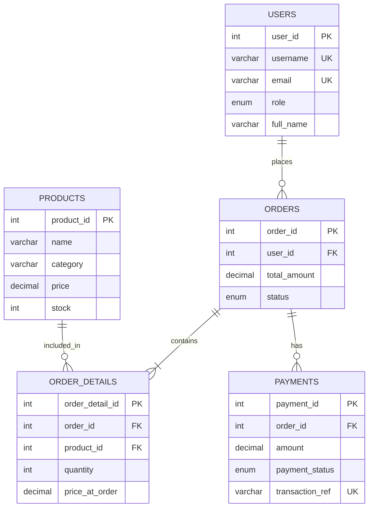

# Probiotic Shop

## การตั้งค่าไฟล์ `.env` (ต้องทำแยก Backend และ Frontend)

ในโปรเจกต์นี้มี environment 2 ส่วน และต้องสร้างไฟล์ `.env` ในแต่ละโฟลเดอร์แยกกัน:

```text
probiotic-shop/
├─ backend/
│  ├─ .env.example   # ตัวอย่างค่าของ Express/MySQL/SMTP
│  └─ .env           # ไฟล์ใช้งานจริง ห้าม commit ขึ้น GitHub
└─ frontend/
   ├─ .env.example   # ตัวอย่าง URL ของ Backend
   └─ .env            # ไฟล์ใช้งานจริง ห้าม commit ขึ้น GitHub
```

### 1. Backend `.env`

เปิด PowerShell จากโฟลเดอร์โปรเจกต์ แล้วรัน:

```powershell
Copy-Item backend/.env.example backend/.env
```

จากนั้นแก้ไขไฟล์ `backend/.env`:

```env
PORT=3000
DB_HOST=localhost
DB_PORT=3306
DB_USER=root
DB_PASSWORD=รหัสผ่าน MySQL ของเครื่องนี้
DB_NAME=probiotic_shop

# ใช้สร้างและตรวจสอบ JWT ควรเป็น string ยาวและสุ่ม ห้ามใช้ค่า example ใน Production
JWT_SECRET=ใส่ค่าสุ่มยาวอย่างน้อย 32 ตัวอักษร
JWT_EXPIRES_IN=1h

# Origin ของ Vue ที่อนุญาตให้เรียก API
CLIENT_URL=http://localhost:5173

# จำนวนครั้งที่ขอ Forgot Password ได้ต่อชั่วโมงในโหมดทดสอบ
FORGOT_PASSWORD_MAX=20
```

ความหมายของค่าหลัก:

- `DB_HOST`, `DB_PORT`, `DB_USER`, `DB_PASSWORD`, `DB_NAME`: ข้อมูลเชื่อมต่อ MySQL
- `JWT_SECRET`: กุญแจลับสำหรับเซ็น JWT ห้ามเปิดเผยหรือ push ขึ้น GitHub
- `JWT_EXPIRES_IN`: อายุ Token เช่น `1h`, `7d`
- `CLIENT_URL`: URL Frontend ที่ Backend จะอนุญาตผ่าน CORS
- `FORGOT_PASSWORD_MAX`: จำนวนครั้งสูงสุดของ Forgot Password ต่อ IP ต่อชั่วโมง

ถ้าต้องการใช้ Forgot Password ผ่าน Gmail ให้เพิ่มค่าต่อไปนี้ใน `backend/.env`:

```env
SMTP_HOST=smtp.gmail.com
SMTP_PORT=587
SMTP_SECURE=false
SMTP_USER=อีเมล Gmail ของร้าน
SMTP_PASSWORD=Gmail App Password 16 หลัก
MAIL_FROM=อีเมลผู้ส่ง
```

ควรใช้ Gmail App Password แทนรหัสผ่าน Gmail จริง และห้ามส่งค่าเหล่านี้ให้ผู้อื่นหรือ commit ลง Git

### 2. Frontend `.env`

สร้างไฟล์จากตัวอย่าง:

```powershell
Copy-Item frontend/.env.example frontend/.env
```

ไฟล์ `frontend/.env` ใช้เพียงค่าเดียว:

```env
VITE_API_URL=http://localhost:3000/api
```

`VITE_API_URL` ต้องลงท้ายด้วย `/api` เพราะ Axios ใช้ค่านี้เป็น `baseURL` เช่น:

- `GET /products` จะเรียก `http://localhost:3000/api/products`
- `POST /auth/login` จะเรียก `http://localhost:3000/api/auth/login`

หลังแก้ `.env` ต้อง restart Vite และ Backend เพราะ environment จะถูกอ่านตอนเริ่ม process เท่านั้น

### 3. สิ่งที่ห้ามทำ

- ห้ามเปลี่ยนชื่อไฟล์เป็น `.env.example.env`
- ห้ามใส่ `VITE_` ในค่าลับ เช่น password หรือ JWT secret เพราะค่าที่ขึ้นต้นด้วย `VITE_` จะถูกส่งไปฝั่ง Browser
- ห้าม commit ไฟล์ `backend/.env` และ `frontend/.env`
- ถ้าเผลอ push SMTP password หรือ JWT secret ให้เปลี่ยนค่าใหม่ทันที
- ระบบไม่ใช้ `normalizeEmail()` เพราะอาจลบจุดใน Gmail เช่น `test.user@gmail.com`; ระบบจะเก็บอีเมลเป็น lowercase แต่คงจุดไว้

เว็บร้านขายสินค้า Probiotic พัฒนาด้วย Vue.js, Express.js และ MySQL

## ความสามารถของระบบ

- Register/Login ด้วย Username และ Password
- JWT Authentication และแยกสิทธิ์ Admin/Customer
- Forgot Password และ Reset Password ผ่าน Email
- Admin เพิ่ม แก้ไข ลบ ค้นหา และ Import สินค้าจาก JSON
- ลูกค้าดูสินค้า กรอง Category และเพิ่มสินค้าลงตะกร้า
- สร้าง Order และกลับมาชำระเงิน Pending ต่อภายหลังได้
- บันทึก Payment และดาวน์โหลดใบเสร็จ PDF
- Dashboard ยอดขายรายวันและยอดขายแยกตามสินค้า

## สิ่งที่ต้องติดตั้ง

- Node.js 22 หรือใหม่กว่า
- MySQL 8.0 หรือใหม่กว่า

## ติดตั้งฐานข้อมูล

สร้างฐานข้อมูลและตารางจากไฟล์ `backend/schema.sql`

```bash
mysql -u root -p < backend/schema.sql
```

หรือเปิดไฟล์ `backend/schema.sql` ใน MySQL Workbench แล้วกด Execute

## ตั้งค่า Backend

```bash
cd backend
npm install
copy .env.example .env
```

แก้ไข `backend/.env` ให้ตรงกับเครื่องของผู้พัฒนา:

```env
PORT=3000
DB_HOST=localhost
DB_PORT=3306
DB_USER=root
DB_PASSWORD=
DB_NAME=probiotic_shop
JWT_SECRET=ใส่ค่าความลับที่ยาวและสุ่ม
JWT_EXPIRES_IN=1h
CLIENT_URL=http://localhost:5173
```

สำหรับ Forgot Password ต้องกำหนด SMTP เพิ่มใน `.env` โดยใช้ Gmail App Password หรือ SMTP ของผู้ให้บริการอีเมล

รัน Backend:

```bash
npm run dev
```

API จะทำงานที่ `http://localhost:3000`

## ตั้งค่า Frontend

```bash
cd frontend
npm install
```

สร้างไฟล์ `frontend/.env`:

```env
VITE_API_URL=http://localhost:3000/api
```

รัน Frontend:

```bash
npm run dev
```

เปิดเว็บที่ `http://localhost:5173`

## สร้างบัญชี Admin

```bash
cd backend
node scripts/seedAdmin.js
```

ค่าบัญชีเริ่มต้นอยู่ในไฟล์สคริปต์ ควรเปลี่ยนรหัสผ่านทันทีหลังทดสอบ และไม่ควรใช้บัญชีตัวอย่างใน Production

## ตัวอย่าง API สำหรับ Postman/Thunder Client

### Register และรับ JWT Token

```http
POST http://localhost:3000/api/auth/register
Content-Type: application/json
```

```json
{
  "username": "testuser01",
  "email": "testuser01@example.com",
  "password": "Test@1234",
  "full_name": "Test User",
  "phone": "0812345678",
  "address": "Bangkok"
}
```

นำค่า `token` จาก Response ไปใช้กับ API ที่ต้อง Login:

```http
Authorization: Bearer YOUR_TOKEN
```

### Login ด้วย Email หรือ Username

```http
POST http://localhost:3000/api/auth/login
Content-Type: application/json
```

```json
{
  "identifier": "testuser01@example.com",
  "password": "Test@1234"
}
```

ฟิลด์ `identifier` สามารถเปลี่ยนเป็น Username ได้ เช่น `testuser01` โดยใช้ Password เดิม

### API หลัก

| Method | Endpoint | สิทธิ์ |
|---|---|---|
| POST | `/api/auth/register` | Public |
| POST | `/api/auth/login` | Public |
| GET | `/api/auth/me` | Login |
| GET | `/api/products` | Login |
| POST | `/api/products` | Admin |
| PUT | `/api/products/:id` | Admin |
| DELETE | `/api/products/:id` | Admin |
| POST | `/api/products/import-json` | Admin |
| POST | `/api/orders` | Customer |
| GET | `/api/orders/mine` | Customer |
| POST | `/api/payments` | Customer |
| GET | `/api/dashboard/sales` | Admin |

## Import สินค้าจาก JSON

ตัวอย่างไฟล์อยู่ที่ `backend/examples/products.sample.json`

รองรับทั้งรูปแบบ Array และ Object ที่มีฟิลด์ `products` โดยแต่ละรายการต้องมี `name`, `price` และ `stock` เช่น:

```json
[
  {
    "name": "Probiotic Original 30 Capsules",
    "description": "โปรไบโอติกแบบแคปซูล",
    "category": "โปรไบโอติกแบบแคปซูล",
    "price": 390,
    "stock": 25
  }
]
```

## โครงสร้างความสัมพันธ์ของข้อมูล



## ขั้นตอนทดสอบหน้าเว็บ

1. สมัครสมาชิกและ Login เป็น Customer
2. ตรวจสอบรายการสินค้าและกรอง Category
3. เพิ่มสินค้าเข้าตะกร้าและสร้าง Order
4. ออกจากหน้าชำระเงิน แล้วกลับเข้าตะกร้าเพื่อกด “ชำระเงินต่อ”
5. ชำระเงินและดาวน์โหลดใบเสร็จ PDF
6. Login เป็น Admin ตรวจสอบ CRUD/ค้นหา/Import JSON สินค้า
7. เปิด Dashboard ตรวจสอบยอดขายและกราฟ

## Git Workflow สำหรับสมาชิก 2 คน

```bash
git switch -c feature/ชื่อฟังก์ชัน
git add .
git commit -m "feat: คำอธิบายการเปลี่ยนแปลง"
git push -u origin feature/ชื่อฟังก์ชัน
```

ให้เปิด Pull Request เพื่อรวมงานเข้าช่องทางหลัก และไม่ commit ไฟล์ `.env`, `node_modules` หรือ `dist`

