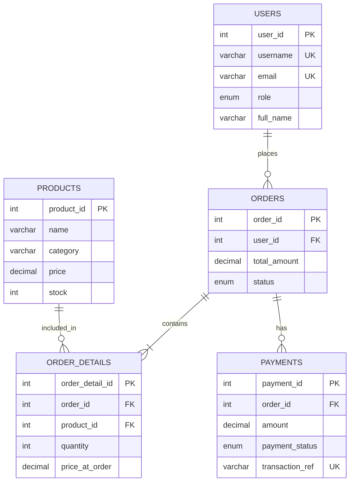

# Probiotic Shop

เว็บร้านขายสินค้า Probiotic พัฒนาด้วย Vue.js, Express.js และ MySQL

## ความสามารถของระบบ

- Register/Login ด้วย Username และ Password
- JWT Authentication และแยกสิทธิ์ Admin/Customer
- Forgot Password และ Reset Password ผ่าน Email
- Admin เพิ่ม แก้ไข ลบ ค้นหา และ Import สินค้าจาก JSON
- ลูกค้าดูสินค้า กรอง Category และเพิ่มสินค้าลงตะกร้า
- สร้าง Order และกลับมาชำระเงิน Pending ต่อภายหลังได้
- บันทึก Payment และดาวน์โหลดใบเสร็จ PDF
- Dashboard ยอดขายรายวันและยอดขายแยกตามสินค้า

## สิ่งที่ต้องติดตั้ง

- Node.js 22 หรือใหม่กว่า
- MySQL 8.0 หรือใหม่กว่า

## ติดตั้งฐานข้อมูล

สร้างฐานข้อมูลและตารางจากไฟล์ `backend/schema.sql`

```bash
mysql -u root -p < backend/schema.sql
```

หรือเปิดไฟล์ `backend/schema.sql` ใน MySQL Workbench แล้วกด Execute

## ตั้งค่า Backend

```bash
cd backend
npm install
copy .env.example .env
```

แก้ไข `backend/.env` ให้ตรงกับเครื่องของผู้พัฒนา:

```env
PORT=3000
DB_HOST=localhost
DB_PORT=3306
DB_USER=root
DB_PASSWORD=
DB_NAME=probiotic_shop
JWT_SECRET=ใส่ค่าความลับที่ยาวและสุ่ม
JWT_EXPIRES_IN=1h
CLIENT_URL=http://localhost:5173
```

สำหรับ Forgot Password ต้องกำหนด SMTP เพิ่มใน `.env` โดยใช้ Gmail App Password หรือ SMTP ของผู้ให้บริการอีเมล

รัน Backend:

```bash
npm run dev
```

API จะทำงานที่ `http://localhost:3000`

## ตั้งค่า Frontend

```bash
cd frontend
npm install
```

สร้างไฟล์ `frontend/.env`:

```env
VITE_API_URL=http://localhost:3000/api
```

รัน Frontend:

```bash
npm run dev
```

เปิดเว็บที่ `http://localhost:5173`

## สร้างบัญชี Admin

```bash
cd backend
node scripts/seedAdmin.js
```

ค่าบัญชีเริ่มต้นอยู่ในไฟล์สคริปต์ ควรเปลี่ยนรหัสผ่านทันทีหลังทดสอบ และไม่ควรใช้บัญชีตัวอย่างใน Production

## ตัวอย่าง API สำหรับ Postman/Thunder Client

### Register และรับ JWT Token

```http
POST http://localhost:3000/api/auth/register
Content-Type: application/json
```

```json
{
  "username": "testuser01",
  "email": "testuser01@example.com",
  "password": "Test@1234",
  "full_name": "Test User",
  "phone": "0812345678",
  "address": "Bangkok"
}
```

นำค่า `token` จาก Response ไปใช้กับ API ที่ต้อง Login:

```http
Authorization: Bearer YOUR_TOKEN
```

### API หลัก

| Method | Endpoint | สิทธิ์ |
|---|---|---|
| POST | `/api/auth/register` | Public |
| POST | `/api/auth/login` | Public |
| GET | `/api/auth/me` | Login |
| GET | `/api/products` | Login |
| POST | `/api/products` | Admin |
| PUT | `/api/products/:id` | Admin |
| DELETE | `/api/products/:id` | Admin |
| POST | `/api/products/import-json` | Admin |
| POST | `/api/orders` | Customer |
| GET | `/api/orders/mine` | Customer |
| POST | `/api/payments` | Customer |
| GET | `/api/dashboard/sales` | Admin |

## Import สินค้าจาก JSON

ตัวอย่างไฟล์อยู่ที่ `backend/examples/products.sample.json`

รองรับทั้งรูปแบบ Array และ Object ที่มีฟิลด์ `products` โดยแต่ละรายการต้องมี `name`, `price` และ `stock` เช่น:

```json
[
  {
    "name": "Probiotic Original 30 Capsules",
    "description": "โปรไบโอติกแบบแคปซูล",
    "category": "โปรไบโอติกแบบแคปซูล",
    "price": 390,
    "stock": 25
  }
]
```

## โครงสร้างความสัมพันธ์ของข้อมูล



## ขั้นตอนทดสอบหน้าเว็บ

1. สมัครสมาชิกและ Login เป็น Customer
2. ตรวจสอบรายการสินค้าและกรอง Category
3. เพิ่มสินค้าเข้าตะกร้าและสร้าง Order
4. ออกจากหน้าชำระเงิน แล้วกลับเข้าตะกร้าเพื่อกด “ชำระเงินต่อ”
5. ชำระเงินและดาวน์โหลดใบเสร็จ PDF
6. Login เป็น Admin ตรวจสอบ CRUD/ค้นหา/Import JSON สินค้า
7. เปิด Dashboard ตรวจสอบยอดขายและกราฟ

## Git Workflow สำหรับสมาชิก 2 คน

```bash
git switch -c feature/ชื่อฟังก์ชัน
git add .
git commit -m "feat: คำอธิบายการเปลี่ยนแปลง"
git push -u origin feature/ชื่อฟังก์ชัน
```

ให้เปิด Pull Request เพื่อรวมงานเข้าช่องทางหลัก และไม่ commit ไฟล์ `.env`, `node_modules` หรือ `dist`

